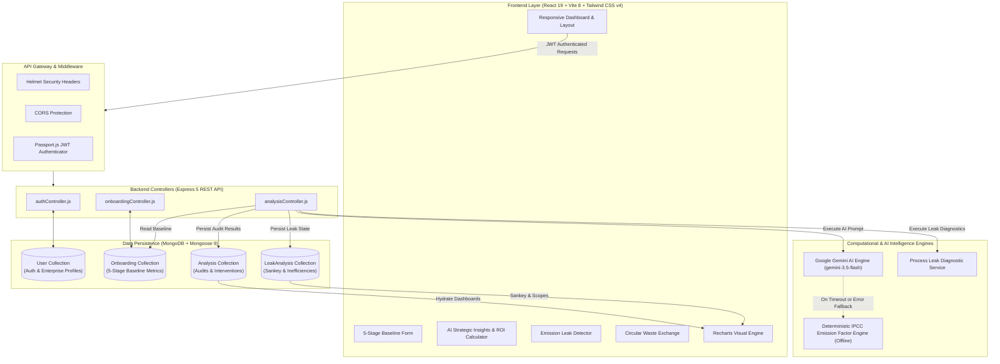

# 🌱 CarbonTrace — Comprehensive Industrial Decarbonization & Circular Economy Platform

<p align="center">
  
</p>

<p align="center">
  <a href="#-features"></a>
  <a href="#-features"></a>
  <a href="#-features"></a>
  <a href="#-features"></a>
  <a href="#-features"></a>
  <a href="#-features"></a>
  <a href="#-features"></a>
  <a href="#-security-architecture"></a>
  <a href="#-emission-calculation-models"></a>
</p>

<p align="center">
  <b>Decarbonize Today. A Greener Tomorrow.</b><br />
  <i>Empowering Small & Medium Enterprises (SMEs) and industrial manufacturers to measure, analyze, reduce, and monetize their carbon emissions through intelligent, circular interventions.</i>
</p>

---

## 📖 Table of Contents

- [What is CarbonTrace?](#-what-is-carbontrace)
- [The Problem vs. The CarbonTrace Solution](#-the-problem-vs-the-carbontrace-solution)
- [Key Features](#-key-features)
  - [1. 5-Stage Comprehensive Baseline Onboarding](#1-5-stage-comprehensive-baseline-onboarding)
  - [2. Dual-Engine Carbon Footprint Accounting](#2-dual-engine-carbon-footprint-accounting)
  - [3. Actionable AI Strategic Insights & Executive Summaries](#3-actionable-ai-strategic-insights--executive-summaries)
  - [4. Process Emission Leak Detector & Inefficiency Identifier](#4-process-emission-leak-detector--inefficiency-identifier)
  - [5. Dynamic ROI & Capital Payback Simulator](#5-dynamic-roi--capital-payback-simulator)
  - [6. B2B Waste Reusability & Circular Byproduct Exchange](#6-b2b-waste-reusability--circular-byproduct-exchange)
  - [7. Executive Sustainability Dashboard & Analytics](#7-executive-sustainability-dashboard--analytics)
  - [8. Enterprise Authentication & Security](#8-enterprise-authentication--security)
- [System Architecture](#-system-architecture)
- [Technology Stack](#-technology-stack)
- [Project Directory Structure](#-project-directory-structure)
- [Quick Start Guide](#-quick-start-guide)
- [API Reference](#-api-reference)
- [Mathematical & Emission Calculation Models](#-mathematical--emission-calculation-models)
- [Security & Environmental Data Governance](#-security--environmental-data-governance)
- [Roadmap](#-roadmap)
- [License](#-license)

---

## 💡 What is CarbonTrace?

**CarbonTrace** is an enterprise-grade sustainability intelligence and decarbonization management platform designed specifically for manufacturing, processing, and industrial supply chain facilities.

For most small-to-medium enterprises (SMEs) and heavy manufacturing plants, auditing greenhouse gas (GHG) emissions across complex operational tiers has historically required exorbitant environmental consulting fees, opaque proprietary software, or months of tedious spreadsheet calculations.

**CarbonTrace eliminates that friction.** By translating raw factory operational metrics—electricity tariffs, diesel logs, raw material compositions, process flow, and waste manifests—into verified Scope 1, Scope 2, and Scope 3 emissions, CarbonTrace provides organizations with an **immediate, deterministic, and AI-optimized pathway toward Net Zero**.

CarbonTrace pairs **deterministic IPCC emission calculation algorithms** with **Google Gemini generative intelligence** to deliver actionable interventions, estimated capital expenditures, payback periods in Indian Rupees (₹ INR), and circular economy matchmaking for industrial waste streams.

---

## ⚡ The Problem vs. The CarbonTrace Solution

| The Traditional Industrial Struggle | The CarbonTrace Advantage |
| :--- | :--- |
| **Expensive, Slow Audits:** Hiring specialized ESG consultants takes months and tens of thousands of dollars. | **Instant Automated Auditing:** Complete a 5-step operational baseline in minutes and generate real-time carbon audit reports. |
| **Opaque Spreadsheets:** Fragmented Excel sheets with outdated emission factors lead to inaccurate reporting and compliance risks. | **Dual-Engine Precision:** Combines standard IPCC emission factor calculations with Google Gemini AI validation for high-accuracy Scope 1–3 reporting. |
| **Abstract Advice:** Generic sustainability advice (e.g., "reduce energy") provides no actionable blueprint or engineering roadmap. | **Ranked Engineering Interventions:** Prioritized recommendations categorized by capital cost (₹ INR), payback period (years), and exact $tCO_2e/yr$ reduction. |
| **Hidden Inefficiencies:** Process bottlenecks in boilers, dryers, and wastewater go unnoticed and bleed emissions. | **Emission Leak Detector:** Automatically scans factory workflows, categorizes equipment emissions, and pinpoints leaks with root-cause insights. |
| **Waste Treated as Cost:** Plants pay haulers high disposal fees to dump industrial slag, scrap, and thermal flue gases into landfills. | **Circular Byproduct Exchange:** Identifies target buyers (foundries, cement kilns, recyclers) and estimates market value ranges (₹/ton) for industrial waste. |
| **Unclear Financial Payback:** CFOs hesitate on green initiatives without tangible ROI or amortization forecasts. | **Interactive ROI Simulator:** Adjust forecast horizons, inflation rates, and capital caps to model cumulative financial savings and breakeven horizons. |

---

## ✨ Key Features

### 1. 5-Stage Comprehensive Baseline Onboarding
- **Stage 1 — Business Profile:** Captures industry classification (Manufacturing, Textiles, Metallurgy, Chemicals), annual production volume, units, and baseline evaluation period.
- **Stage 2 — Energy & Materials:** Ingests grid electricity ($kWh$), on-site diesel ($L$), natural gas ($m^3$), coal ($kg$), and separates virgin raw materials from recycled feedstocks to account for upstream circularity.
- **Stage 3 — Waste Management:** Logs scrap volume, effluent, ash, and categorizes end-of-life disposal routes (Landfill, Incineration, Recycling, Composting).
- **Stage 4 — Manufacturing Processes:** Maps internal workflows (e.g., smelting, spinning, curing, dyeing) directly to specific energy and material consumption nodes.
- **Stage 5 — Costs & Constraints:** Collects utility spend, raw material expenses, waste haulage costs, available capital budget, and preferred payback timelines (e.g., $1\text{–}3$ years).

### 2. Dual-Engine Carbon Footprint Accounting
- **Google Gemini Generative AI:** Synthesizes multi-variable plant data to detect subtle thermodynamic inefficiencies and generate contextualized industrial recommendations.
- **Deterministic IPCC Fallback Engine:** Built-in offline mathematical model based on standardized IPCC emission factors guarantees 100% platform availability even when external AI APIs are unconfigured or unreachable.
- **Scope 1, Scope 2, and Scope 3 Classification:** Automatically segregates direct combustion (Scope 1), purchased grid electricity (Scope 2), and supply chain/waste lifecycle emissions (Scope 3).

### 3. Actionable AI Strategic Insights & Executive Summaries
- **Executive AI Narrative:** Generates a board-ready summary outlining total annual carbon intensity ($tCO_2e/\text{year}$), primary operational hotspots, and strategic targets.
- **Top Emission Hotspot Breakdown:** Visual percentage ranking of the top 3–4 emission drivers across the enterprise.
- **Ranked Circular Interventions:** Concrete engineering recommendations with:
  - Implementation Category (Material Circularity, Thermal Recovery, Waste Optimization)
  - Estimated Capital Cost (in Indian Rupees: ₹ Lakhs / Thousands)
  - Estimated Payback Period (in years)
  - Expected Carbon Abatement ($tCO_2e/\text{year}$)
  - Priority Badge (`HIGH`, `MEDIUM`, `LOW`)

### 4. Process Emission Leak Detector & Inefficiency Identifier
- **Dedicated Diagnostic Engine:** Input specific operational parameters (Industry Type, Fuel Source, Monthly Electricity, Feedstocks, Wastewater, Logistics).
- **Equipment-Level Carbon Disaggregation:** Isolates high-bleed machinery including industrial boilers, drying ovens, grid infrastructure, fleet haulage, and effluent treatment plants.
- **Sankey Flow Allocation:** Tracks volumetric flow from individual equipment nodes into respective Scope 1, 2, or 3 categories.
- **Root-Cause Inefficiency Insights:** Delivers pinpoint diagnosis for each leak point (e.g., *"Boiler: Incomplete coal combustion & thermal radiation losses"*).

### 5. Dynamic ROI & Capital Payback Simulator
- **Interactive Financial Modeling:** Visualizes cumulative capital outlay vs. projected operational cost savings across multi-year horizons.
- **Configurable Scenario Sliders:**
  - Investment Horizon ($1\text{–}10$ Years)
  - Expected Energy & Material Inflation Rate ($0\text{–}15\%$)
  - Capital Budget Cap (custom ₹ expenditure boundary)
- **Breakeven Timeline Curves:** Dual-layer visual charts (Capex vs. Amortized Savings) highlighting the exact month of investment payback.

### 6. B2B Waste Reusability & Circular Byproduct Exchange
- **Industrial Symbiosis Matching:** Turns waste liability into secondary revenue streams by matching industrial outputs to cross-industry inputs:
  - **Metal & Industrial Scrap** $\rightarrow$ Electric Arc Furnace Foundries & Steel Rolling Mills (₹22,000 – ₹35,000 / ton)
  - **Ash, Slag & Mineral Residue** $\rightarrow$ Eco-Cement & Green Concrete Clinker Plants (₹1,500 – ₹3,000 / ton)
  - **Packaging, Polymers & Organics** $\rightarrow$ Recycled Packaging & Auxiliary Fuel Formulators (₹8,000 – ₹15,000 / ton)
- **Landfill Diversion Tracking:** Demonstrates concrete circular economy metrics for ESG disclosures and carbon credit potential.

### 7. Executive Sustainability Dashboard & Analytics
- **Live Recharts Visualizations:**
  - Multi-bar charts of monthly Scope 1, 2, and 3 emissions trends
  - Donut & pie charts of source contributions
  - Sparklines tracking energy intensity and recycling ratios
- **Currency & Metric Localization:** Built with native Indian Rupee formatting (`formatINR`) and international SI metric tonnes ($tCO_2e$).

### 8. Enterprise Authentication & Security
- **Stateless JWT Security:** Industry-standard JSON Web Token authentication with passport-jwt integration.
- **Data Isolation:** Every onboarding profile, analysis run, and leak diagnosis is strictly scoped to the authenticated organization's `User` record.
- **Cryptographic Storage:** Passwords hashed with salted `bcryptjs` routines.
- **HTTP Hardening:** Complete protection against malicious request vectors via Express `helmet` and strict `cors` policies.

---

## 🏗️ System Architecture



---

## 💻 Technology Stack

| Layer | Technology | Details & Purpose |
| :--- | :--- | :--- |
| **Frontend Framework** | **React 19** (`react` `^19.2.8`) | Modern component architecture, hooks, and seamless state reactivity |
| **Build Tool & Bundler** | **Vite 8** (`vite` `^8.3.0`) | Lightning-fast HMR, optimized production build pipeline, and API proxying |
| **Styling & Design** | **Tailwind CSS v4** (`@tailwindcss/vite`) | Next-generation utility-first styling engine with zero Bootstrap conflicts |
| **Data Visualizations** | **Recharts 3** (`recharts` `^3.10.1`) | Responsive SVG charts (Bar, Area, Pie, Line) for emission tracking |
| **Animations & Transitions**| **Framer Motion** (`framer-motion` `^13.2.0`) | Smooth multi-step wizard and card entry animations |
| **Icons** | **Lucide React** (`lucide-react` `^1.45.0`) | Modern, consistent iconography across all application screens |
| **Routing** | **React Router DOM v7** (`react-router-dom` `^7.18.3`) | Declarative client-side routing with protected and public route gates |
| **HTTP Client** | **Axios** (`axios` `^1.20.0`) | Automated JWT bearer token injection via request interceptors |
| **Backend Runtime** | **Node.js** (v20+ / v24+) | High-throughput asynchronous server environment |
| **Backend Framework** | **Express.js 5** (`express` `^5.2.1`) | High-performance HTTP server and modular REST API router |
| **Database & Modeling** | **MongoDB** & **Mongoose 9** (`mongoose` `^9.10.0`) | Strongly typed NoSQL document modeling and schema validations |
| **Authentication** | **Passport.js** & **JWT** (`jsonwebtoken`, `passport-jwt`) | Cryptographically signed bearer token authorization |
| **Password Security** | **Bcrypt.js** (`bcryptjs` `^3.0.3`) | One-way salt hashing for sensitive credentials |
| **AI Reasoning** | **Google Gemini AI** (`gemini-3.5-flash`) | Industrial reasoning, narrative synthesis, and intervention scoring |
| **Calculation Engine** | **IPCC Standards Engine** | Deterministic fallback utilizing verified global emission coefficients |
| **Server Security** | **Helmet** (`helmet` `^8.3.0`) & **CORS** (`cors` `^2.8.6`) | HTTP security headers and domain origin restriction |

---

## 📂 Project Directory Structure

```text
Carbontrace/
├── client/                               # Frontend Single Page Application
│   ├── public/                           # Static assets & branding
│   │   ├── favicon.svg                   # Application favicon
│   │   ├── icons.svg                     # Vector icon symbols
│   │   ├── logo.jpg                      # CarbonTrace corporate branding
│   │   └── logo.png                      # High-res transparent logo
│   ├── src/
│   │   ├── api/                          # Axios service clients
│   │   │   ├── axios.js                  # Central Axios instance with Bearer interceptor
│   │   │   ├── authApi.js                # Auth endpoints (login, register, profile)
│   │   │   ├── onboardingApi.js          # Baseline configuration persistence
│   │   │   └── analysisApi.js            # Carbon calculation and leak diagnosis
│   │   ├── assets/                       # UI illustrations and icons
│   │   ├── components/                   # Reusable UI component library
│   │   │   ├── CustomDropdown.jsx        # Accessible animated dropdown
│   │   │   ├── Layout.jsx                # Responsive navigation drawer & header shell
│   │   │   ├── ParticleBackground.jsx    # Aesthetic canvas background for auth pages
│   │   │   ├── ProtectedRoute.jsx        # JWT auth guard redirecting to /login
│   │   │   └── PublicRoute.jsx           # Guest route redirecting logged-in users
│   │   ├── context/
│   │   │   └── AuthContext.jsx           # Global user authentication provider
│   │   ├── pages/                        # Application view controllers
│   │   │   ├── AuthPage.jsx              # User login screen
│   │   │   ├── RegisterPage.jsx          # New user registration screen
│   │   │   ├── ForgotPasswordPage.jsx    # Credential recovery interface
│   │   │   ├── OnboardingPage.jsx        # 5-stage comprehensive baseline wizard
│   │   │   ├── Dashboard.jsx             # Unified carbon & sustainability command center
│   │   │   ├── AiInsights.jsx            # Gemini AI executive summaries & interventions
│   │   │   ├── EmissionLeakDetector.jsx  # Process leak diagnosis & equipment flow
│   │   │   ├── RoiCalculator.jsx         # Financial payback & capital cap simulator
│   │   │   ├── WasteExchange.jsx         # B2B circular byproduct matching marketplace
│   │   │   ├── Reports.jsx               # Exportable audit summaries & ESG reports
│   │   │   ├── DataManagement.jsx        # Operational logs & inventory controls
│   │   │   └── Settings.jsx              # Account profile, preferences, and feedback
│   │   ├── utils/
│   │   │   └── currency.js               # Indian Rupee (₹ INR) localization utility
│   │   ├── App.css                       # Application base styles
│   │   ├── App.jsx                       # Root route declarations & layout wrappers
│   │   ├── index.css                     # Tailwind CSS v4 styling rules & custom validation
│   │   └── main.jsx                      # Vite React entry point
│   ├── .env.example                      # Client environment configuration template
│   ├── index.html                        # HTML5 document shell
│   ├── package.json                      # Frontend dependencies & Vite scripts
│   └── vite.config.js                    # Vite configuration with proxy rules
├── server/                               # Backend REST API & Computation Services
│   ├── config/
│   │   ├── db.js                         # Mongoose MongoDB connection initializer
│   │   └── passport.js                   # Passport-JWT strategy authentication setup
│   ├── controllers/
│   │   ├── authController.js             # User registration, token generation, profile
│   │   ├── onboardingController.js       # Ingestion and retrieval of 5-stage baseline
│   │   └── analysisController.js         # Carbon audit execution & leak detector APIs
│   ├── models/
│   │   ├── User.js                       # User credentials and organization profile
│   │   ├── Onboarding.js                 # Business, energy, materials, waste, costs schemas
│   │   ├── Analysis.js                   # Total footprint, top sources, circular recommendations
│   │   └── LeakAnalysis.js               # Equipment leak diagnosis and Sankey flow states
│   ├── routes/
│   │   ├── auth.js                       # /api/auth routes
│   │   ├── onboarding.js                 # /api/onboarding routes
│   │   └── analysis.js                   # /api/analysis routes
│   ├── services/
│   │   ├── geminiService.js              # Google Gemini AI integration & IPCC fallback engine
│   │   └── leakDetectorService.js        # Machinery diagnostic & Scope mapping engine
│   ├── .env.example                      # Server environment configuration template
│   ├── index.js                          # Express application entry point & HTTP listener
│   └── package.json                      # Server dependencies & execution scripts
├── agent.md                              # UI consistency rules & Tailwind architectural guidelines
├── .gitignore                            # Monorepo git exclusion rules
└── README.md                             # Comprehensive project documentation
```

---

## 🚀 Quick Start Guide

### Prerequisites

Ensure you have the following installed on your development machine:
- **Node.js:** v18.x or higher (v20+ recommended)
- **npm:** v9.x or higher
- **MongoDB:** Community Edition running locally (`mongodb://127.0.0.1:27017`) or a free [MongoDB Atlas](https://www.mongodb.com/atlas) cloud connection string
- **Google Gemini API Key:** *(Optional for rule-based calculations; required for AI-generated executive summaries and custom circular interventions)*. Get a free API key at [Google AI Studio](https://aistudio.google.com/).

---

### Step 1: Clone the Repository

```bash
git clone https://github.com/aarshpatel12345/hackout_2026.git
cd Carbontrace
```

---

### Step 2: Configure & Run Backend Server

1. Open a terminal and navigate to the `server` directory:
   ```bash
   cd server
   ```

2. Install dependencies:
   ```bash
   npm install
   ```

3. Configure your server environment variables:
   ```bash
   cp .env.example .env
   ```

   **`server/.env` Configuration:**
   ```dotenv
   PORT=5000
   MONGO_URI=mongodb://127.0.0.1:27017/carbon_trace
   JWT_SECRET=your_super_secret_jwt_key_here
   CLIENT_URL=http://localhost:5173
   GEMINI_API_KEY=your_google_gemini_api_key_here
   ```

   > **Note on AI Fallbacks:** If `GEMINI_API_KEY` is not provided, CarbonTrace automatically switches to its deterministic **IPCC Standard Emission Factor Engine**, so all calculations and recommendations continue to work seamlessly offline.

4. Start the backend development server:
   ```bash
   npm run dev
   ```
   *The server will start at `http://localhost:5000` with live reload via nodemon.*

---

### Step 3: Configure & Run Frontend Client

1. Open a second terminal and navigate to the `client` directory:
   ```bash
   cd client
   ```

2. Install dependencies:
   ```bash
   npm install
   ```

3. Verify client environment variables:
   ```bash
   cp .env.example .env
   ```

   **`client/.env` Configuration:**
   ```dotenv
   VITE_API_URL=/api
   ```
   *(Vite's built-in dev proxy automatically forwards `/api` requests to `http://127.0.0.1:5000`, eliminating any CORS or localhost mismatches.)*

4. Start the frontend development server:
   ```bash
   npm run dev
   ```
   *Open your browser and navigate to [http://localhost:5173](http://localhost:5173).*

---

### Step 4: Step-by-Step Walkthrough

1. **Sign Up:** Create a new enterprise account at `/register`.
2. **Complete Baseline:** You will be guided through the **5-Stage Baseline Wizard** (`/onboarding`) to input your company's energy, raw materials, waste streams, processes, and budget constraints.
3. **Explore Dashboard:** View your unified carbon footprint breakdown across Scopes 1, 2, and 3 at `/dashboard`.
4. **Inspect AI Insights:** Review AI-generated executive summaries and high-priority circular interventions with estimated capital costs and payback timelines at `/ai-insights`.
5. **Run Leak Diagnostics:** Test your factory parameters in the **Emission Leak Detector** (`/leak-detector`) to detect equipment inefficiencies and view Scope flow distributions.
6. **Simulate ROI:** Adjust investment horizons and budget constraints in the **ROI Calculator** (`/roi-calculator`) to visualize your capital payback curves.
7. **Monetize Byproducts:** Explore the **Waste Reusability** module (`/waste-exchange`) to discover B2B buyer organizations and market values for your waste streams.

---

## 📡 API Reference

### 1. Authentication Endpoints (`/api/auth`)

| Method | Endpoint | Access | Description |
| :--- | :--- | :--- | :--- |
| `POST` | `/api/auth/register` | Public | Register new enterprise user (`name`, `email`, `password`) |
| `POST` | `/api/auth/login` | Public | Authenticate credentials and return signed JWT token |
| `GET` | `/api/auth/profile` | Bearer Token | Retrieve currently authenticated user profile |

**Example Registration Payload:**
```json
{
  "name": "Sustainability Lead",
  "email": "lead@greenmetals.com",
  "password": "SecurePassword123"
}
```

---

### 2. Baseline Onboarding Endpoints (`/api/onboarding`)

| Method | Endpoint | Access | Description |
| :--- | :--- | :--- | :--- |
| `POST` | `/api/onboarding` | Bearer Token | Save or update 5-stage comprehensive operational baseline |
| `GET` | `/api/onboarding` | Bearer Token | Fetch saved baseline data for authenticated enterprise |

**Example Onboarding Payload Structure:**
```json
{
  "business": {
    "industry": "Metallurgy & Forging",
    "productionQuantity": 15000,
    "productionUnit": "metric tons/yr",
    "analysisPeriod": "Annual (2025-2026)"
  },
  "energy": [
    { "energyType": "Electricity (Grid)", "quantity": 750000, "unit": "kWh/yr" },
    { "energyType": "Diesel", "quantity": 35000, "unit": "L/yr" }
  ],
  "materials": [
    { "materialName": "Virgin Steel", "quantity": 180000, "unit": "kg", "materialType": "Virgin" },
    { "materialName": "Recycled Scrap", "quantity": 60000, "unit": "kg", "materialType": "Recycled" }
  ],
  "waste": [
    { "wasteType": "Foundry Slag", "quantity": 45000, "unit": "kg", "disposalMethod": "Landfill" }
  ],
  "processes": [
    { "processName": "Induction Melting", "energyAssociated": "Electricity", "materialAssociated": "Steel" }
  ],
  "costs": {
    "energyCost": 4500000,
    "materialCost": 8500000,
    "wasteCost": 350000,
    "currency": "INR"
  },
  "constraints": {
    "availableBudget": 1500000,
    "preferredPaybackPeriod": "1-3 years"
  }
}
```

---

### 3. Carbon Analysis & AI Insights Endpoints (`/api/analysis`)

| Method | Endpoint | Access | Description |
| :--- | :--- | :--- | :--- |
| `POST` | `/api/analysis/calculate` | Optional Token | Execute AI carbon audit with Gemini / IPCC engine and persist results |
| `GET` | `/api/analysis` | Optional Token | Retrieve latest computed carbon analysis and ranked recommendations |
| `POST` | `/api/analysis/leak-detector`| Optional Token | Execute diagnostic leak detection on machinery parameters |
| `GET` | `/api/analysis/leak-detector` | Optional Token | Retrieve stored leak analysis and equipment allocations |

**Example Analysis Response:**
```json
{
  "totalCarbonFootprint": 1240,
  "unit": "tCO2e/year",
  "topEmissionSources": [
    { "source": "Electricity (Grid)", "emissions": 615, "unit": "tCO2e", "percentage": 50 },
    { "source": "Virgin Steel", "emissions": 324, "unit": "tCO2e", "percentage": 26 },
    { "source": "Diesel", "emissions": 94, "unit": "tCO2e", "percentage": 8 }
  ],
  "aiSummaryParagraph": "Based on comprehensive Scope 1-3 carbon accounting, your enterprise generates an estimated 1,240 tCO2e/year. The primary emission driver is Grid Electricity, accounting for 50% of emissions. Transitioning high-impact feedstock to certified recycled scrap and deploying waste-heat recovery can reduce net footprint by up to 24% with an average payback of 1.6 years.",
  "recommendations": [
    {
      "id": 1,
      "title": "Shift 30% virgin steel to certified recycled scrap",
      "category": "Material Circularity",
      "co2Reduction": "120 tCO2e/year",
      "estimatedCost": "₹8.5 lakh",
      "payback": "1.8 years",
      "priority": "HIGH",
      "description": "Procure secondary scrap feedstock for primary induction furnaces to reduce Scope 3 embodied carbon."
    }
  ],
  "wasteReuseMatches": [
    {
      "id": 1,
      "strategyName": "Direct Foundry Scrap Sales",
      "strategyDescription": "Briquette high-purity scrap to sell to regional electric arc foundries.",
      "wasteUsedAsRawMaterial": "Foundry Slag / Scrap",
      "targetOrganizations": "Foundries, Rolling Mills, metallurgy plants",
      "marketValueRange": "₹22,000 - ₹35,000 / ton"
    }
  ],
  "calculationEngine": "Google Gemini AI (gemini-3.5-flash)",
  "analyzedAt": "2026-10-25T14:00:00.000Z"
}
```

---

## 🧮 Mathematical & Emission Calculation Models

CarbonTrace adheres to the **GHG Protocol Corporate Standard** and **IPCC Guidelines for National Greenhouse Gas Inventories**, modeling total emissions across Scopes 1, 2, and 3:

$$\text{Total Carbon Footprint } (tCO_2e) = \sum E_{\text{Scope 1}} + \sum E_{\text{Scope 2}} + \sum E_{\text{Scope 3}}$$

### Standardized Emission Factors Applied

| Category | Input Stream | Factor Value | Unit | Basis / Reference |
| :--- | :--- | :--- | :--- | :--- |
| **Energy** | Grid Electricity | $0.00082$ | $tCO_2e\text{ / kWh}$ | National average grid carbon intensity |
| **Energy** | Diesel Fuel | $0.00268$ | $tCO_2e\text{ / Liter}$ | Direct stationary & mobile combustion |
| **Energy** | Natural Gas | $0.00200$ | $tCO_2e\text{ / }m^3$ | Industrial thermal generation |
| **Energy** | Coal | $0.00240$ | $tCO_2e\text{ / kg}$ | Sub-bituminous boiler combustion |
| **Energy** | Solar / Wind | $0.00005$ | $tCO_2e\text{ / kWh}$ | Lifecycle balance-of-system footprint |
| **Materials** | Virgin Steel | $0.00180$ | $tCO_2e\text{ / kg}$ | Blast furnace / basic oxygen furnace route |
| **Materials** | Recycled Steel | $0.00045$ | $tCO_2e\text{ / kg}$ | **75% abatement** via electric arc circularity |
| **Materials** | Virgin Aluminum | $0.00890$ | $tCO_2e\text{ / kg}$ | Primary smelting electrolytic route |
| **Materials** | Polyethylene / Plastic | $0.00250$ | $tCO_2e\text{ / kg}$ | Petrochemical polymer synthesis |
| **Waste** | Landfill Disposal | $0.00050$ | $tCO_2e\text{ / kg}$ | Anaerobic decomposition & fugitive methane |
| **Waste** | Incineration | $0.00070$ | $tCO_2e\text{ / kg}$ | Thermal oxidation without energy capture |
| **Waste** | Mechanical Recycling | $0.00010$ | $tCO_2e\text{ / kg}$ | Secondary material processing credit |

### Financial ROI & Payback Formulation

For any suggested circular intervention:

$$\text{Payback Period (Years)} = \frac{\text{Estimated Initial Capex (₹)}}{\text{Net Annual Operational Savings (₹/yr)}}$$

Where annual operational savings represent the sum of avoided energy costs, reduced virgin material expenses, avoided landfill tipping fees, and revenue from circular byproduct sales.

---

## 🛡️ Security & Environmental Data Governance

- **Zero Untrusted Code Execution:** CarbonTrace only analyzes declarative operational parameters and never compiles or executes arbitrary scripts.
- **Strict Tenant Isolation:** Every database document (`Onboarding`, `Analysis`, `LeakAnalysis`) carries a strict Mongoose reference to the authenticated `User` ID, preventing cross-organization data leakage.
- **Prompt Sanitization:** Industrial input data passed to Google Gemini is strictly formatted as structured JSON payloads with strict temperature controls ($0.2$) and enforced JSON schemas.
- **Cryptographic Security:** Passwords are never stored in plaintext and are salted and hashed with `bcryptjs`. Session authorization utilizes standard stateless JWT tokens verified on every protected route.
- **Resilient Fallback Mode:** In environments with strict external firewall rules or missing AI credentials, CarbonTrace functions fully autonomously using its internal IPCC calculation engine.

---

## 🗺️ Roadmap

- [x] 5-Stage Comprehensive Baseline Onboarding
- [x] Dual-Engine Carbon Footprint Engine (Gemini AI + IPCC Fallbacks)
- [x] Equipment Emission Leak Detector with Sankey scope allocation
- [x] Interactive ROI & Capital Payback Simulator in ₹ INR
- [x] Circular Economy & B2B Byproduct Matchmaking
- [ ] Automated BRSR (Business Responsibility and Sustainability Reporting) PDF Generation
- [ ] IoT Smart Meter Ingestion (Modbus / MQTT telemetry for real-time electricity & gas tracking)
- [ ] Supplier Scope 3 Tier-N Carbon Footprint Portal
- [ ] Carbon Credit Tokenization & Offset Marketplace Integration

---

## 📄 License

This project is licensed under the [MIT License](LICENSE).

---

<p align="center">
  <b>CarbonTrace</b> — Decarbonize Today. A Greener Tomorrow. 🌱
</p>
